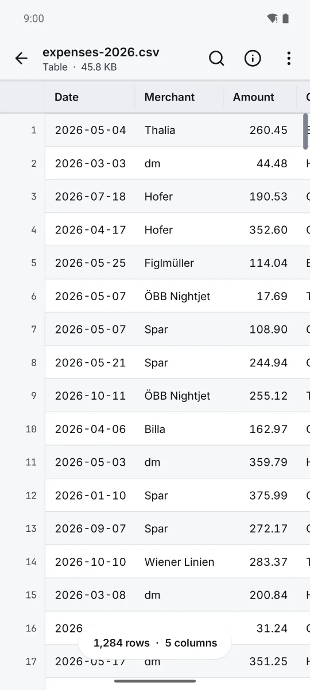

  

<h1 align="center">Pure Peek</h1>

Open any file on Android and see it properly. Photos at full quality, PDF, CSV and Excel, code and more. Free, no ads, no internet.

  <a href="https://play.google.com/store/apps/details?id=com.zanoshky.purepeek"><b>Google Play</b></a> ·
  <a href="https://purepeek.zanoski.com"><b>purepeek.zanoski.com</b></a> ·
  <a href="https://zanoshky.github.io/pure-peek-app/"><b>User guide</b></a> ·
  <a href="https://github.com/Zanoshky/pure-peek-app/issues/new/choose"><b>Report a bug</b></a>

  

This repo is the public home for Pure Peek users: the user guide, bug reports and feature requests. The app itself is a free Android app with an optional Pro, and its source is not here.

## Quick start

1. Install Pure Peek from Google Play. It runs on Android 10 or newer.
2. Tap a file in Files, Gmail or Drive. When Android asks which app to use, pick Pure Peek and Always.
3. Or open Pure Peek and tap Open files, Open a folder or Photos.

## The guide

| Page | What is in it |
| --- | --- |
| [Guide](https://zanoshky.github.io/pure-peek-app/guide.html) | Opening files, every kind of file, find, settings |
| [Questions](https://zanoshky.github.io/pure-peek-app/faq.html) | Answers and fixes for common problems |
| [Report a bug](https://zanoshky.github.io/pure-peek-app/report.html) | What to include in a good report |

The guide pages are plain HTML in [docs](docs), built by `python3 build.py`.

## Report a bug or ask for a feature

1. Search the [open issues](https://github.com/Zanoshky/pure-peek-app/issues) first. If yours is there, add a thumbs up or a comment.
2. Otherwise open a [bug report](https://github.com/Zanoshky/pure-peek-app/issues/new?template=bug_report.yml) or a [feature request](https://github.com/Zanoshky/pure-peek-app/issues/new?template=feature_request.yml).
3. Add your app version, phone model and Android version, and a screenshot if you can. Issues are public, so share nothing private.

## License

The guide text and images in this repo are shared under [CC BY 4.0](LICENSE). The Pure Peek app itself is proprietary and is not covered by this license.
